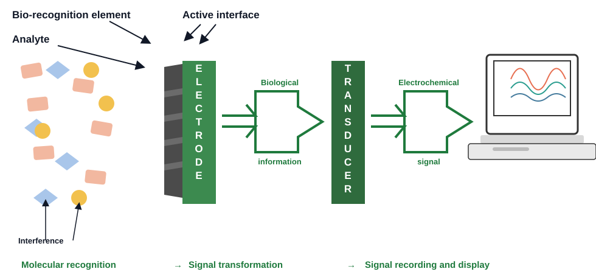
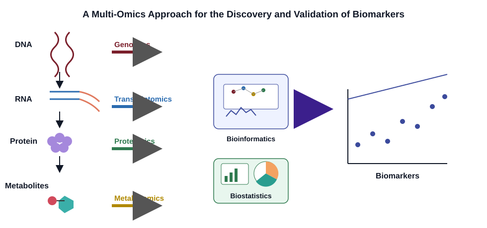
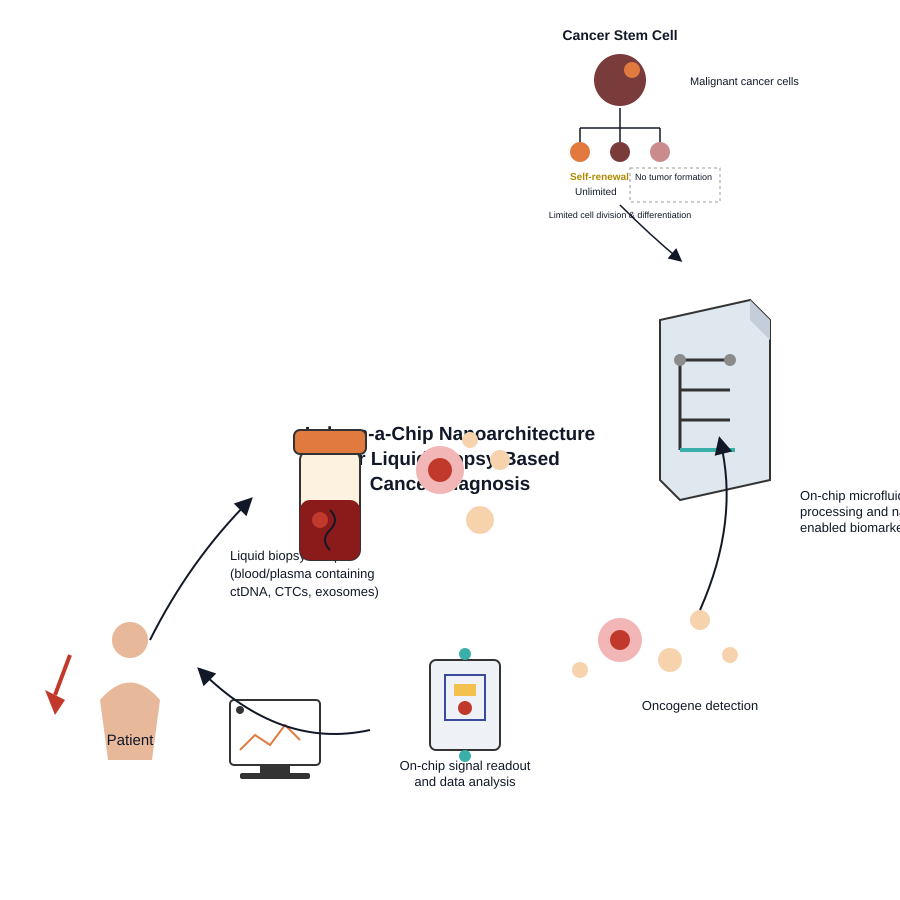
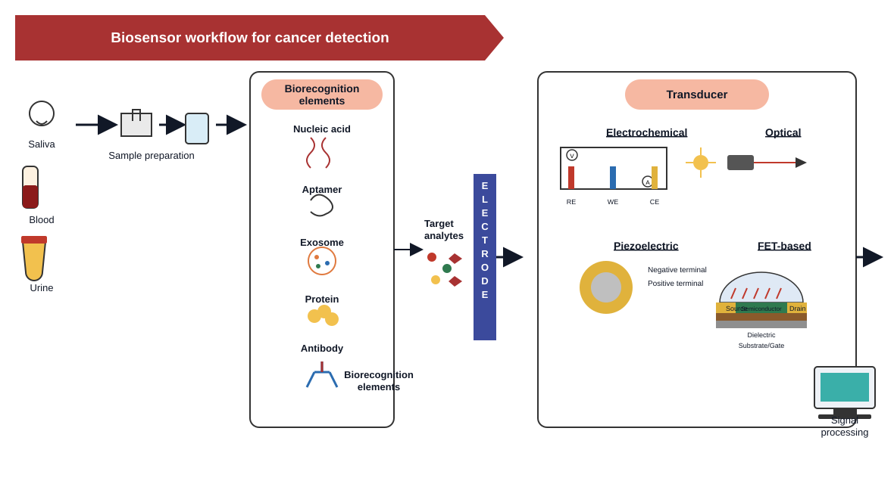

# BioSense-GovAI

> 🇰🇷 [한국어](#한국어) · 🇺🇸 [English](#english)

AI-powered **biomarker–biosensor co-design** SaaS platform for early cancer detection, combining ctDNA molecular characteristics, Korean public health statistics, and literature-backed evidence.

| Signal transduction | Multi-omics discovery |
|---|---|
|  |  |

| Liquid-biopsy lab-on-a-chip | Biorecognition–transducer workflow |
|---|---|
|  |  |

These four concept diagrams are also rendered on the app's landing page (`/`, "Biosensor Design Concepts" section) and live as SVG assets under [`docs/assets/`](docs/assets) / [`apps/web/public/diagrams/`](apps/web/public/diagrams).

---

<a id="한국어"></a>
## 한국어

### 1. 프로그램 개요

**BioSense-GovAI**는 암 조기진단용 **바이오마커-바이오센서 공동설계(co-design)**를 지원하는 AI SaaS 플랫폼입니다. 바이오센서 스타트업, 대학 연구자, 진단기기 기업을 대상으로, 특정 암종에 대해 어떤 ctDNA 바이오마커를 선택하고 어떤 인식 소자(recognition element)·트랜스듀서(transducer)로 센서를 설계해야 하는지에 대한 근거 기반 R&D 설계 리포트를 자동으로 생성합니다.

핵심 아이디어는 "감(perception)"이 아니라 **근거(evidence)** 기반 설계입니다:

- 국가암등록통계·KOSIS 등 **한국 공공 역학 데이터**로 암종/지역별 발생률·사망률을 제시
- **NCI GDC(Genomic Data Commons)** 연동으로 유전자 수준 변이·메틸화 데이터를 조회
- **PubMed 문헌 수집 + RAG(검색증강생성)**로 관련 논문 근거를 자동 인용
- 바이오마커 후보 스코어링 → DNA 하이브리다이제이션/CRISPR-Cas 인식 전략 → 전기화학/광학/압전/FET 센서 후보까지 이어지는 **파이프라인**으로 리포트를 구성
- 데이터가 없는 항목은 추정치로 꾸며내지 않고 "데이터 없음(Missing data)"으로 명시하여 **정직한 불확실성 표기**를 지향

### 2. 주요 기능 (화면 기준)

| 화면 | 설명 |
|------|------|
| `/dashboard` | 로그인 후 전체 현황 대시보드 |
| `/rnd-design` | **R&D 설계 리포트** — 암종/바이오마커 종류/타겟 유전자/지역/환자 연령을 입력하면, 역학적 근거 → 바이오마커 후보 → 분자적 특성 → 인식 전략 → 센서 후보 → 근거 문헌 → 실험 설계 가설 → 한계점 → 참고문헌까지 12단계 리포트와 바이오센서 파이프라인 다이어그램(검체→생체인식→트랜스듀서→신호판독)을 생성 |
| `/recommendations` | 바이오마커 케이스 기반 AI 추천 엔진 |
| `/reports` | 생성된 리포트 열람 |
| `/admin/literature` | 문헌(논문) 업로드/수집 상태 관리, RAG 품질 평가 |
| `/sign-in`, `/sign-up` | Supabase Auth 기반 인증 |

### 3. 기술 스택

| 계층 | 기술 |
|------|------|
| Frontend | Next.js 15, TypeScript, Tailwind CSS, shadcn/ui |
| Backend | FastAPI (Python 3.12), Clean Architecture |
| Database | Supabase (PostgreSQL + pgvector), Neo4j 5 (지식 그래프) |
| AI | OpenAI (LLM/임베딩), RAG, Knowledge Graph, 추천 엔진 |
| 외部 데이터 소스 | KOSIS/KDCA(한국 공공데이터), NCI GDC(유전체), PubMed(문헌) |
| 인증 | Supabase Auth |
| 인프라 | Docker, Vercel(웹), Railway(API/DB — 선택) |

### 4. API 개요 (`/v1`)

| 그룹 | 대표 엔드포인트 |
|------|----------------|
| Health | `GET /v1/health` |
| Users | `GET /v1/me` |
| R&D 설계 | `POST /v1/rnd/design` — 암종·바이오마커로 12단계 설계 리포트 생성 |
| Biomarkers | `GET /v1/biomarkers/methylation-evidence` |
| Catalog | `GET /v1/cancers`, `/v1/biomarkers`, `/v1/sources`, `/v1/evidence`, `/v1/global-cancer-statistics` |
| Ingestion | `POST /v1/ingestion/jobs/trigger`, `GET /v1/ingestion/jobs`, `GET /v1/public-data/cancer-stats` |
| Literature/RAG | `GET/POST /v1/literature/papers*`, `POST /v1/literature/rag/query`, `POST /v1/literature/rag/evaluate` |
| Recommendations | `POST /v1/recommendations/generate` |
| Knowledge Graph | `POST /v1/sync/schema`, `/v1/sync/domain`, `/v1/sync/gene` |

전체 계약: [`packages/openapi/openapi.yaml`](packages/openapi/openapi.yaml) · 대화형 문서: `http://localhost:8000/docs`

### 5. 실행 방법

#### 사전 요구사항

- Docker & Docker Compose
- Node.js 20+
- Python 3.12+ (API를 Docker 없이 로컬 실행할 경우)

#### 5-1. 환경 변수 설정

```bash
cp .env.example .env
# .env를 열어 Supabase, OpenAI 등의 키를 입력 (docs/SUPABASE.md 참고)
```

주요 항목:
- `DATABASE_URL`, `SUPABASE_URL`, `SUPABASE_ANON_KEY`, `SUPABASE_SERVICE_ROLE_KEY`, `SUPABASE_JWT_SECRET`
- `NEO4J_URI`, `NEO4J_USER`, `NEO4J_PASSWORD`
- `OPENAI_API_KEY`, `OPENAI_MODEL`, `OPENAI_EMBEDDING_MODEL`
- (선택) `KOSIS_API_KEY`, `KDCA_API_URL/KEY`, `PUBMED_API_KEY` — 미설정 시 시드 JSON으로 폴백

#### 5-2. Docker Compose로 전체 스택 실행 (권장)

```bash
docker compose up -d
```

| 서비스 | 주소 |
|--------|------|
| Web | http://localhost:3000 |
| API | http://localhost:8000 |
| API 문서(Swagger) | http://localhost:8000/docs |
| Neo4j Browser | http://localhost:7474 |

헬스체크:

```bash
curl http://localhost:8000/v1/health
```

#### 5-3. Docker 없이 로컬 개발

**API 서버:**

```bash
cd apps/api
pip install ".[dev]"
uvicorn biosense.api.main:app --reload --port 8000
```

**웹 프론트엔드:**

```bash
cd apps/web
npm install
npm run dev
```

기본적으로 웹은 `/api/*` 요청을 `API_URL`(기본 `http://127.0.0.1:8000`)로 프록시합니다 ([next.config.ts](apps/web/next.config.ts)).

#### 5-4. 테스트

```bash
# API 단위 테스트
cd apps/api
pytest

# 웹 타입 체크
cd apps/web
npx tsc --noEmit
```

### 6. 프로젝트 구조

```
apps/
  web/          # Next.js 15 프론트엔드 (App Router)
  api/          # FastAPI 백엔드 (도메인/애플리케이션/인프라 계층 분리)
packages/
  openapi/      # API 계약 정의 (source of truth)
infra/
  db/migrations/  # PostgreSQL + Neo4j 마이그레이션
docs/           # 아키텍처 및 로드맵 문서
```

### 7. 배포

- **웹(Next.js)**: Vercel 프로젝트에 연결됨 (`apps/web`, standalone 빌드) — `vercel --prod` 또는 Vercel Git 연동으로 자동 배포
- **API/DB**: Railway 또는 임의의 Docker 호스트에 `apps/api/Dockerfile`로 배포. 배포 환경에서는 `.env`의 `NEXT_PUBLIC_API_URL`을 실제 API 도메인으로 지정해야 함

### 8. 문서

- [시스템 아키텍처](docs/SYSTEM_ARCHITECTURE.md) — 다이어그램, 이벤트 흐름, 엔티티, API 목록, 배포
- [데이터 아키텍처](docs/DATA_ARCHITECTURE.md) — Postgres + Neo4j 스키마, ORM, 마이그레이션, 시드
- [아키텍처 심화](docs/ARCHITECTURE.md)
- [로드맵](docs/ROADMAP.md)
- [디렉터리 구조](docs/DIRECTORY_STRUCTURE.md)
- [Supabase 설정](docs/SUPABASE.md)

### 9. Multi-Omics R&D 고도화 현황 (Phase 1 – Phase 2)

`Cancer → Multi-Omics Data → Biomarker Candidate → Molecular Characterization → Molecular Recognition → Signal Transduction → Biosensor Design → Evidence-backed Recommendation` 파이프라인으로의 확장이 단계적으로 진행 중입니다. **이 시스템은 진단 시스템이 아니며, 모든 결과는 연구 지원용(research support only)이고 실험적 검증이 필요합니다.**

**Phase 1 — 파이프라인 골격 구축**
Mutation 차원(ctDNA), DNA 하이브리다이제이션, CRISPR-Cas(휴리스틱), 전기화학 센서를 하나의 파이프라인으로 연결하고 `/v1/rnd/design`에 통합. Biomarker 3-dimension 모델(Mutation/Methylation/Fragmentomics), 분자적 특성화(molecular_characterization), 분자 인식 엔진(molecular_recognition), 센서 트랜스듀서 엔진(sensor_transduction), 6-factor R&D 스코어링, 경량 온톨로지 매핑 도입.

**Phase 1.5 — 과학적 엄밀성 보강 (하드닝)**
- 미구현 항목을 "supported"로 표기하지 않도록 UI 문구를 "planned / architecture-ready / not yet implemented"로 정정
- `BiomarkerEvidenceStatus`(SUPPORTED/PARTIALLY_SUPPORTED/INSUFFICIENT_EVIDENCE/PLANNED) 도입, 각 상태에 근거(reason) 명시
- 신규 `molecular_detectability` 도메인 도입 — "바이오마커가 존재하는가"와 "실제로 검출 가능한가"를 구분, 데이터 없는 항목은 절대 숫자를 지어내지 않고 `unknown`으로 처리
- 인식 전략 결정 흐름을 `Biomarker → Molecular Characteristics → Detectability → Recognition Strategy`로 강제 (바이오마커 이름만으로 즉시 추천하지 않음)
- 인식 적합성 매트릭스를 evidence_level/source/rationale/confidence를 갖는 데이터로 외부화(생물학적 정설로 취급하지 않음)
- 근거 출처(Evidence Provenance) 필드 확장: dataset, original_identifier, access_date, access_level, evidence_type
- Score(순위용)와 Confidence(근거 강도)를 명확히 분리, R&D 스코어링 가중치는 "초기 휴리스틱 가중치 — 검증되지 않음"으로 명시
- 근거 배제 후 재계산하는 counterfactual(evidence sensitivity) 스캐폴드 도입
- "근거 불충분(Insufficient evidence) 상태가 실수로 높은 신뢰도로 둔갑하지 않는지" 검증하는 회귀 테스트 추가
- 178개 테스트 통과 (기존 160 + 신규 18), 회귀 없음

**Phase 2 — 실데이터 연동 (Feasibility Audit 우선)**
구현 전 `docs/data-feasibility-phase2.md`로 NCI GDC/TCGA·PubMed·Europe PMC의 실제 API 구조를 먼저 검증(가정으로 진행하지 않음). 검증 결과에 따라 범위를 정직하게 축소:
- **Methylation = 메타데이터 전용 연동.** GDC `/files`, `/projects` API는 파일 단위 메타데이터(플랫폼, 접근 등급, 케이스 수)만 제공하며 실제 CpG-site/beta value는 제공하지 않음(원시 파일 다운로드·오프라인 처리가 별도로 필요, 현재 범위 밖). LUAD/LUSC/COAD/READ/BRCA 5개 TCGA 코호트의 오픈 액세스 메틸레이션 파일 존재를 실제 API로 확인. 근거 상태는 파일이 있으면 `PARTIALLY_SUPPORTED`, 없으면 `INSUFFICIENT_EVIDENCE`이며 **절대 `SUPPORTED`로 표시하지 않음**.
- **CRISPR-Cas = 인용 문헌 연동.** PubMed/Europe PMC에서 실제 인용(PMID/DOI 등)을 조회해 추천에 연결하되, 논문에서 LOD/민감도/특이도 등 수치를 자동 추출하지 않음(수동 큐레이션 필요). 근거 상태는 인용 발견 시 `HEURISTIC_WITH_CITATIONS`, 없으면 기존과 동일한 `HEURISTIC`.
- 신규 `GET /v1/biomarkers/methylation-evidence` 엔드포인트, 내부 전용 근거 등급 체계(LEVEL_A–E/UNKNOWN, 외부 과학 표준 아님을 명시), `docs/scoring-calibration.md`(실제 벤치마크 데이터셋이 아직 없어 스코어링 가중치 보정은 보류함을 명시)
- 191개 테스트 통과 (기존 178 + 신규 13), 회귀 없음

**현재 구현 상태 요약**

| 구분 | 항목 |
|------|------|
| 실제 구현(Evidence-backed) | Mutation 특성화, DNA 하이브리다이제이션, 전기화학 센서, GDC 메틸레이션 메타데이터 검색 |
| 휴리스틱 / 인용 보강 | CRISPR-Cas 인식(휴리스틱 스코어링 + 실제 문헌 인용 부착) |
| 부분 지원 | Methylation (파일/프로젝트 단위 메타데이터만, 정량값 없음) |
| 계획됨 (미구현) | Fragmentomics, Expression/Protein/Fusion/Copy-number 차원, Aptamer/Antibody/Affinity 인식, Optical/SERS/SPR/Fluorescence 센서 |

**다음 단계 후보 (Phase 3)**: 메틸레이션 원시 파일(IDAT/TXT) 다운로드·파싱 파이프라인, CRISPR 구조화 근거(LOD/민감도 등)의 전문가 수동 큐레이션, 스코어링 보정을 위한 실제 벤치마크 데이터셋 구축.

### 10. 라이선스

Proprietary — BioSense-GovAI

---

<a id="english"></a>
## English

### 1. Overview

**BioSense-GovAI** is an AI-powered SaaS platform for **biomarker–biosensor co-design** in early cancer detection. It targets biosensor startups, university researchers, and diagnostic-device companies, automatically generating an evidence-backed R&D design report that answers: *which ctDNA biomarker should we target, and which recognition element / transducer should the sensor use, for a given cancer type?*

The platform is built around **evidence over intuition**:

- Real **Korean public epidemiological data** (national cancer registry / KOSIS) for incidence and mortality by cancer type and region
- **NCI GDC (Genomic Data Commons)** integration for gene-level mutation and methylation data
- **PubMed literature ingestion + RAG (Retrieval-Augmented Generation)** to automatically cite supporting papers
- A pipeline that scores biomarker candidates, proposes a DNA-hybridization / CRISPR-Cas recognition strategy, and ranks electrochemical / optical / piezoelectric / FET-based sensor candidates
- Any field without real data is explicitly labeled **"No data"** rather than fabricated — the platform never invents numbers to fill gaps

### 2. Key Features (by screen)

| Screen | Description |
|--------|-------------|
| `/dashboard` | Post-login overview dashboard |
| `/rnd-design` | **R&D Design Report** — enter cancer type, biomarker class, target gene, region, and patient age to generate a 12-section report (epidemiological evidence → biomarker candidates → molecular characteristics → recognition strategy → sensor candidates → supporting literature → experimental design hypothesis → limitations → references), plus a biosensor pipeline diagram (sample → biorecognition → transducer → signal readout) |
| `/recommendations` | AI recommendation engine driven by a biomarker case |
| `/reports` | Browse previously generated reports |
| `/admin/literature` | Manage paper uploads/ingestion status and RAG quality evaluation |
| `/sign-in`, `/sign-up` | Supabase Auth-based authentication |

### 3. Tech Stack

| Layer | Technology |
|-------|------------|
| Frontend | Next.js 15, TypeScript, Tailwind CSS, shadcn/ui |
| Backend | FastAPI (Python 3.12), Clean Architecture |
| Database | Supabase (PostgreSQL + pgvector), Neo4j 5 (knowledge graph) |
| AI | OpenAI (LLM/embeddings), RAG, Knowledge Graph, recommendation engine |
| External data | KOSIS/KDCA (Korean public data), NCI GDC (genomics), PubMed (literature) |
| Auth | Supabase Auth |
| Infra | Docker, Vercel (web), Railway (api/db — optional) |

### 4. API Overview (`/v1`)

| Group | Representative endpoints |
|-------|---------------------------|
| Health | `GET /v1/health` |
| Users | `GET /v1/me` |
| R&D Design | `POST /v1/rnd/design` — generates the 12-section design report for a cancer/biomarker pair |
| Biomarkers | `GET /v1/biomarkers/methylation-evidence` |
| Catalog | `GET /v1/cancers`, `/v1/biomarkers`, `/v1/sources`, `/v1/evidence`, `/v1/global-cancer-statistics` |
| Ingestion | `POST /v1/ingestion/jobs/trigger`, `GET /v1/ingestion/jobs`, `GET /v1/public-data/cancer-stats` |
| Literature/RAG | `GET/POST /v1/literature/papers*`, `POST /v1/literature/rag/query`, `POST /v1/literature/rag/evaluate` |
| Recommendations | `POST /v1/recommendations/generate` |
| Knowledge Graph | `POST /v1/sync/schema`, `/v1/sync/domain`, `/v1/sync/gene` |

Full contract: [`packages/openapi/openapi.yaml`](packages/openapi/openapi.yaml) · Interactive docs: `http://localhost:8000/docs`

### 5. Getting Started

#### Prerequisites

- Docker & Docker Compose
- Node.js 20+
- Python 3.12+ (only needed to run the API without Docker)

#### 5-1. Environment

```bash
cp .env.example .env
# Fill in Supabase, OpenAI, and other keys (see docs/SUPABASE.md)
```

Key variables:
- `DATABASE_URL`, `SUPABASE_URL`, `SUPABASE_ANON_KEY`, `SUPABASE_SERVICE_ROLE_KEY`, `SUPABASE_JWT_SECRET`
- `NEO4J_URI`, `NEO4J_USER`, `NEO4J_PASSWORD`
- `OPENAI_API_KEY`, `OPENAI_MODEL`, `OPENAI_EMBEDDING_MODEL`
- (optional) `KOSIS_API_KEY`, `KDCA_API_URL/KEY`, `PUBMED_API_KEY` — fall back to seed JSON if unset

#### 5-2. Full stack via Docker Compose (recommended)

```bash
docker compose up -d
```

| Service | URL |
|---------|-----|
| Web | http://localhost:3000 |
| API | http://localhost:8000 |
| API docs (Swagger) | http://localhost:8000/docs |
| Neo4j Browser | http://localhost:7474 |

Health check:

```bash
curl http://localhost:8000/v1/health
```

#### 5-3. Local development without Docker

**API server:**

```bash
cd apps/api
pip install ".[dev]"
uvicorn biosense.api.main:app --reload --port 8000
```

**Web frontend:**

```bash
cd apps/web
npm install
npm run dev
```

By default the web app proxies `/api/*` requests to `API_URL` (default `http://127.0.0.1:8000`) — see [next.config.ts](apps/web/next.config.ts).

#### 5-4. Tests

```bash
# API unit tests
cd apps/api
pytest

# Web type check
cd apps/web
npx tsc --noEmit
```

### 6. Project Structure

```
apps/
  web/          # Next.js 15 frontend (App Router)
  api/          # FastAPI backend (domain/application/infrastructure layers)
packages/
  openapi/      # API contract (source of truth)
infra/
  db/migrations/  # PostgreSQL + Neo4j migrations
docs/           # Architecture & roadmap docs
```

### 7. Deployment

- **Web (Next.js)**: linked to a Vercel project (`apps/web`, standalone build) — deploy with `vercel --prod` or via Vercel's Git integration
- **API/DB**: deploy `apps/api/Dockerfile` to Railway or any Docker host. In production, set `NEXT_PUBLIC_API_URL` in the web app's environment to the real API domain

### 8. Documentation

- [System Architecture](docs/SYSTEM_ARCHITECTURE.md) — diagrams, event flow, entities, API list, deployment
- [Data Architecture](docs/DATA_ARCHITECTURE.md) — Postgres + Neo4j schema, ORM, migrations, seeds
- [Architecture (deep-dive)](docs/ARCHITECTURE.md)
- [Roadmap](docs/ROADMAP.md)
- [Directory Structure](docs/DIRECTORY_STRUCTURE.md)
- [Supabase Setup](docs/SUPABASE.md)

### 9. Multi-Omics R&D Development Status (Phase 1 – Phase 2)

The platform is being extended, in stages, toward the pipeline `Cancer → Multi-Omics Data → Biomarker Candidate → Molecular Characterization → Molecular Recognition → Signal Transduction → Biosensor Design → Evidence-backed Recommendation`. **This is not a diagnostic system — every output is research support only and requires experimental validation.**

**Phase 1 — Pipeline skeleton**
Connected the mutation dimension (ctDNA), DNA hybridization, CRISPR-Cas (heuristic), and an electrochemical sensor into one pipeline wired into `/v1/rnd/design`. Introduced the 3-dimension biomarker model (Mutation/Methylation/Fragmentomics), a molecular characterization module, a molecular recognition engine, a sensor transduction engine, a 6-factor R&D scoring engine, and a lightweight ontology mapping layer.

**Phase 1.5 — Scientific hardening**
- Corrected UI wording so unimplemented items are never labeled "supported" — now "planned / architecture-ready / not yet implemented"
- Added `BiomarkerEvidenceStatus` (SUPPORTED/PARTIALLY_SUPPORTED/INSUFFICIENT_EVIDENCE/PLANNED), each with a stated reason
- Added a new `molecular_detectability` domain, distinguishing "does the biomarker exist" from "can it actually be detected" — unbacked attributes stay `unknown`, never a fabricated number
- Recognition strategy selection now strictly flows `Biomarker → Molecular Characteristics → Detectability → Recognition Strategy` (never decided from biomarker name/type alone)
- Externalized the recognition-compatibility matrix as data carrying evidence_level/source/rationale/confidence (never treated as settled biology)
- Extended evidence provenance fields: dataset, original_identifier, access_date, access_level, evidence_type
- Explicitly separated Score (ranking) from Confidence (evidence strength); R&D scoring weights are labeled "initial heuristic weights — not empirically validated"
- Added a counterfactual/evidence-sensitivity scaffold that recomputes recommendations with one evidence source masked
- Added a regression test guaranteeing "insufficient evidence" can never be silently upgraded to a high-confidence result
- 178 tests passing (160 baseline + 18 new), zero regressions

**Phase 2 — Real data integration (feasibility-audit-first)**
Before writing any implementation code, `docs/data-feasibility-phase2.md` verified the actual NCI GDC/TCGA, PubMed, and Europe PMC API structures against live documentation and endpoints (no assumptions). Scope was honestly narrowed based on those findings:
- **Methylation = metadata-only integration.** The GDC `/files` and `/projects` APIs return only file-level metadata (platform, access tier, case counts) — not real CpG-site IDs or beta values, which would require downloading and offline-processing raw files (out of current scope). Open-access methylation files were confirmed live for all 5 target TCGA cohorts (LUAD, LUSC, COAD, READ, BRCA). Evidence status is `PARTIALLY_SUPPORTED` when files exist, `INSUFFICIENT_EVIDENCE` otherwise — **never `SUPPORTED`**.
- **CRISPR-Cas = citation-linked evidence.** Real citations (PMID/DOI) from PubMed/Europe PMC are now attached to recommendations, but no LOD/sensitivity/specificity values are auto-extracted from paper text (that needs manual curation). Evidence status becomes `HEURISTIC_WITH_CITATIONS` when citations are found, otherwise remains plain `HEURISTIC` as before.
- Added `GET /v1/biomarkers/methylation-evidence`, an internal-only evidence-hierarchy scale (LEVEL_A–E/UNKNOWN, explicitly not an external scientific standard), and `docs/scoring-calibration.md` (states plainly that no real benchmark dataset exists yet, so scoring weights remain uncalibrated rather than guessed)
- 191 tests passing (178 baseline + 13 new), zero regressions

**Current implementation snapshot**

| Category | Items |
|----------|-------|
| Evidence-backed | Mutation characterization, DNA hybridization, electrochemical sensor, GDC methylation metadata search |
| Heuristic / citation-augmented | CRISPR-Cas recognition (heuristic scoring + real literature citations) |
| Partially supported | Methylation (file/project-level metadata only, no quantitative values) |
| Planned (not implemented) | Fragmentomics; expression/protein/fusion/copy-number dimensions; aptamer/antibody/affinity recognition; optical/SERS/SPR/fluorescence sensors |

**Candidate next steps (Phase 3)**: a real bulk methylation processing pipeline (IDAT/TXT parsing), expert manual curation of structured CRISPR evidence (LOD, sensitivity, etc.), and building a real benchmark dataset for score calibration.

### 10. License

Proprietary — BioSense-GovAI
