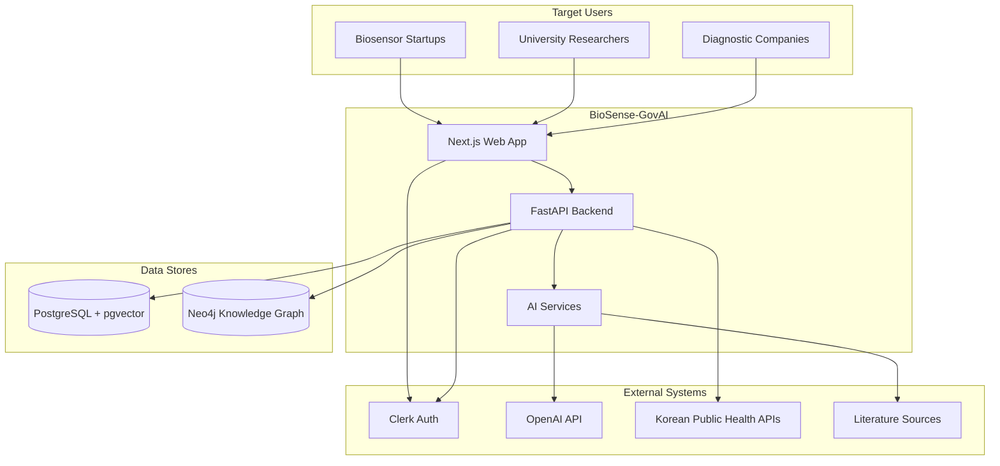
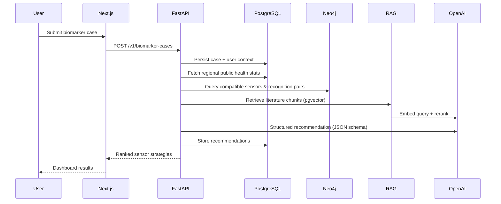
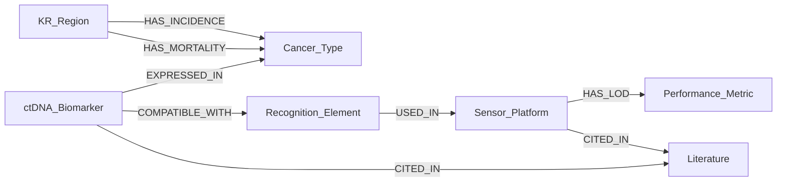
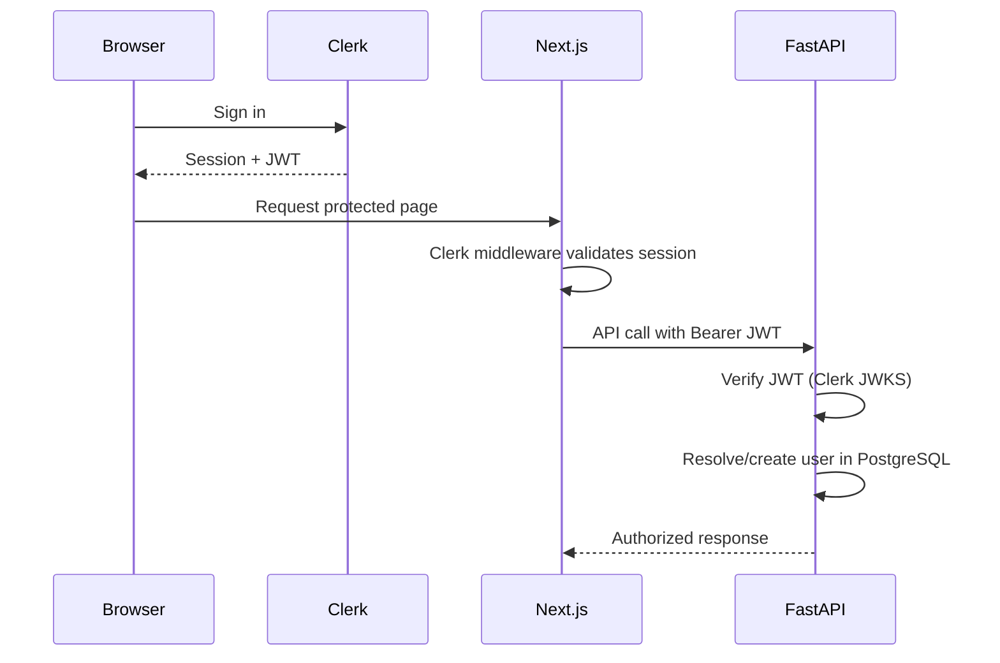
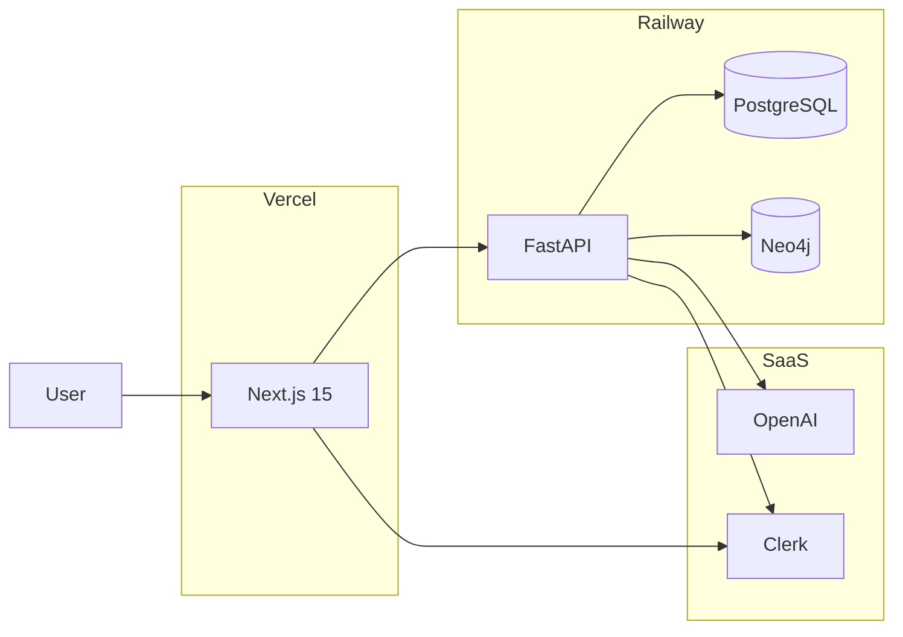
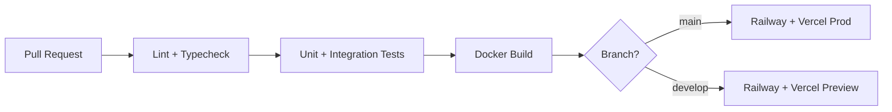

# BioSense-GovAI — System Architecture

> AI-powered biomarker–biosensor co-design platform for early cancer detection using ctDNA molecular characteristics and Korean public health data.

## 1. Executive Summary

BioSense-GovAI is a multi-tenant SaaS that ingests user-defined cancer/ctDNA context, enriches it with Korean public health statistics and scientific literature, queries a biomarker–biosensor knowledge graph, and produces ranked biosensor design recommendations with sensitivity, specificity, LOD, cost, and experimental protocol guidance.

| Concern | Decision | Rationale |
|---------|----------|-----------|
| Frontend | Next.js 15 (App Router, RSC) | SSR for dashboards, Vercel-native deploy |
| Backend | FastAPI (Python) | ML/AI ecosystem, async I/O, OpenAPI |
| Relational DB | PostgreSQL 16 + pgvector | ACID, embeddings, analytics |
| Graph DB | Neo4j 5 | Biomarker–sensor–literature relationships |
| Auth | Clerk | SaaS-ready, JWT, org/team support |
| AI | OpenAI + RAG + KG traversal | Literature grounding + structured reasoning |
| Local dev | Docker Compose | Reproducible full stack |
| Prod deploy | Vercel (web) + Railway (api, db) | Low cost, maintainability |

---

## 2. System Context (C4 Level 1)



---

## 3. Clean Architecture (Backend)

FastAPI follows **ports & adapters** with dependency injection.

```
apps/api/src/biosense/
├── domain/                    # Enterprise business rules (no framework imports)
│   ├── entities/              # BiomarkerCase, Recommendation, SensorStrategy
│   ├── value_objects/         # CtDnaClass, CancerType, RegionCode, LOD
│   ├── repositories/          # Abstract interfaces (ports)
│   └── services/              # RecommendationEngine, CompatibilityScorer
├── application/               # Use cases (orchestration)
│   ├── use_cases/
│   │   ├── create_biomarker_case.py
│   │   ├── search_knowledge_graph.py
│   │   ├── generate_recommendations.py
│   │   └── sync_public_health_data.py
│   └── dto/                   # Request/response models (Pydantic)
├── infrastructure/            # Adapters
│   ├── persistence/
│   │   ├── postgres/          # SQLAlchemy + Alembic
│   │   └── neo4j/             # Neo4j driver, Cypher queries
│   ├── ai/
│   │   ├── openai_client.py
│   │   ├── rag_pipeline.py
│   │   └── embedding_service.py
│   ├── external/
│   │   └── korean_health_client.py
│   └── auth/
│       └── clerk_jwt.py
└── api/                       # Delivery mechanism
    ├── main.py
    ├── dependencies.py
    ├── middleware/
    └── v1/
        ├── router.py
        ├── biomarkers.py
        ├── recommendations.py
        ├── knowledge_graph.py
        ├── public_data.py
        └── health.py
```

### Dependency Rule

```
API → Application → Domain ← Infrastructure
```

Domain never imports from infrastructure. Application wires ports to adapters via DI.

---

## 4. Frontend Architecture (Next.js 15)

```
apps/web/src/
├── app/                       # App Router
│   ├── (auth)/                # Clerk sign-in/up
│   ├── (dashboard)/           # Protected routes
│   │   ├── dashboard/
│   │   ├── biomarkers/
│   │   │   ├── new/
│   │   │   └── [id]/
│   │   ├── knowledge-graph/
│   │   ├── public-data/
│   │   └── recommendations/
│   ├── api/                   # BFF routes (optional proxy)
│   └── layout.tsx
├── components/
│   ├── ui/                    # shadcn/ui primitives
│   └── features/              # Domain components
├── lib/
│   ├── api-client.ts          # Typed fetch from OpenAPI types
│   └── clerk.ts
├── hooks/
└── types/                     # Generated from packages/openapi
```

| Layer | Responsibility |
|-------|----------------|
| Server Components | Dashboard summaries, initial data fetch |
| Client Components | Forms, graph visualization, interactive search |
| Route Handlers | Optional Clerk session → API token proxy |

---

## 5. Core Domain Flows

### 5.1 Recommendation Pipeline



### 5.2 Knowledge Graph Model (Neo4j)



**Node labels:** `CtDnaBiomarker`, `CancerType`, `RecognitionElement`, `SensorPlatform`, `Literature`, `KrRegion`, `PerformanceMetric`

**Key relationships:** `COMPATIBLE_WITH`, `USED_IN`, `CITED_IN`, `HAS_INCIDENCE`, `HAS_MORTALITY`, `RECOMMENDED_FOR`

### 5.3 RAG Pipeline

| Stage | Technology | Output |
|-------|------------|--------|
| Ingest | PubMed/API + PDF parsers | Raw documents |
| Chunk | LangChain / custom splitter | 512-token chunks |
| Embed | `text-embedding-3-small` | 1536-d vectors → pgvector |
| Retrieve | Cosine similarity + metadata filter | Top-k chunks |
| Rerank | LLM cross-encoder or GPT rerank | Top-5 grounded passages |
| Generate | GPT-4o + JSON schema | Structured recommendation |

---

## 6. API Contracts (OpenAPI 3.1)

Canonical spec: [`packages/openapi/openapi.yaml`](../packages/openapi/openapi.yaml)

### Endpoint Summary

| Method | Path | Description | Auth |
|--------|------|-------------|------|
| `GET` | `/v1/health` | Liveness + dependency checks | Public |
| `GET` | `/v1/me` | Current user profile | Bearer |
| `GET` | `/v1/dashboard` | Aggregated user stats | Bearer |
| `POST` | `/v1/biomarker-cases` | Create biomarker input case | Bearer |
| `GET` | `/v1/biomarker-cases` | List user cases | Bearer |
| `GET` | `/v1/biomarker-cases/{id}` | Case detail | Bearer |
| `POST` | `/v1/biomarker-cases/{id}/recommendations` | Run recommendation engine | Bearer |
| `GET` | `/v1/recommendations/{id}` | Recommendation detail | Bearer |
| `GET` | `/v1/public-data/regions` | Korean region list | Bearer |
| `GET` | `/v1/public-data/cancer-stats` | Incidence/mortality by region | Bearer |
| `POST` | `/v1/knowledge-graph/search` | Graph + semantic search | Bearer |
| `GET` | `/v1/knowledge-graph/nodes/{id}` | Node detail + neighbors | Bearer |

### Recommendation Response Schema

```json
{
  "id": "uuid",
  "biomarker_case_id": "uuid",
  "rank": 1,
  "sensor_type": "electrochemical",
  "recognition_strategy": "aptamer-based",
  "expected_sensitivity": 0.92,
  "expected_specificity": 0.95,
  "expected_lod": { "value": 0.1, "unit": "ng/mL" },
  "estimated_cost_usd": 45.0,
  "experimental_protocol": {
    "steps": ["..."],
    "reagents": ["..."],
    "duration_hours": 24
  },
  "confidence_score": 0.87,
  "evidence": {
    "literature_ids": ["pmid:12345"],
    "graph_paths": ["CtDnaBiomarker→RecognitionElement→SensorPlatform"]
  },
  "created_at": "2026-07-01T00:00:00Z"
}
```

---

## 7. Database Schema

### 7.1 PostgreSQL (migrations in `infra/db/migrations/postgres/`)

```sql
-- Extensions
CREATE EXTENSION IF NOT EXISTS "uuid-ossp";
CREATE EXTENSION IF NOT EXISTS vector;

-- Users (synced from Clerk)
CREATE TABLE users (
  id            UUID PRIMARY KEY DEFAULT uuid_generate_v4(),
  clerk_id      TEXT UNIQUE NOT NULL,
  email         TEXT NOT NULL,
  org_name      TEXT,
  role          TEXT NOT NULL DEFAULT 'researcher',
  created_at    TIMESTAMPTZ NOT NULL DEFAULT now(),
  updated_at    TIMESTAMPTZ NOT NULL DEFAULT now()
);

-- Biomarker input cases
CREATE TABLE biomarker_cases (
  id            UUID PRIMARY KEY DEFAULT uuid_generate_v4(),
  user_id       UUID NOT NULL REFERENCES users(id),
  cancer_type   TEXT NOT NULL,
  ctdna_class   TEXT NOT NULL,
  patient_age   INT NOT NULL CHECK (patient_age BETWEEN 0 AND 120),
  region_code   TEXT NOT NULL,
  notes         TEXT,
  status        TEXT NOT NULL DEFAULT 'draft',
  created_at    TIMESTAMPTZ NOT NULL DEFAULT now(),
  updated_at    TIMESTAMPTZ NOT NULL DEFAULT now()
);

-- Recommendations
CREATE TABLE recommendations (
  id                    UUID PRIMARY KEY DEFAULT uuid_generate_v4(),
  biomarker_case_id     UUID NOT NULL REFERENCES biomarker_cases(id),
  rank                  INT NOT NULL,
  sensor_type           TEXT NOT NULL,
  recognition_strategy  TEXT NOT NULL,
  expected_sensitivity  NUMERIC(5,4),
  expected_specificity  NUMERIC(5,4),
  expected_lod_value    NUMERIC,
  expected_lod_unit     TEXT,
  estimated_cost_usd    NUMERIC(10,2),
  experimental_protocol JSONB NOT NULL DEFAULT '{}',
  confidence_score      NUMERIC(5,4),
  evidence              JSONB NOT NULL DEFAULT '{}',
  created_at            TIMESTAMPTZ NOT NULL DEFAULT now()
);

-- Public health cache (Korean data)
CREATE TABLE public_health_stats (
  id              UUID PRIMARY KEY DEFAULT uuid_generate_v4(),
  region_code     TEXT NOT NULL,
  cancer_type     TEXT NOT NULL,
  incidence_rate  NUMERIC,
  mortality_rate  NUMERIC,
  data_year       INT NOT NULL,
  source          TEXT NOT NULL,
  fetched_at      TIMESTAMPTZ NOT NULL DEFAULT now(),
  UNIQUE (region_code, cancer_type, data_year)
);

-- RAG document store
CREATE TABLE literature_documents (
  id            UUID PRIMARY KEY DEFAULT uuid_generate_v4(),
  external_id   TEXT UNIQUE NOT NULL,
  title         TEXT NOT NULL,
  authors       TEXT[],
  published_at  DATE,
  source        TEXT NOT NULL,
  metadata      JSONB NOT NULL DEFAULT '{}',
  created_at    TIMESTAMPTZ NOT NULL DEFAULT now()
);

CREATE TABLE literature_chunks (
  id            UUID PRIMARY KEY DEFAULT uuid_generate_v4(),
  document_id   UUID NOT NULL REFERENCES literature_documents(id),
  chunk_index   INT NOT NULL,
  content       TEXT NOT NULL,
  embedding     vector(1536),
  metadata      JSONB NOT NULL DEFAULT '{}',
  created_at    TIMESTAMPTZ NOT NULL DEFAULT now()
);

CREATE INDEX idx_chunks_embedding ON literature_chunks
  USING ivfflat (embedding vector_cosine_ops) WITH (lists = 100);
```

### 7.2 Neo4j (seed in `infra/db/migrations/neo4j/`)

Constraints and indexes on `CtDnaBiomarker.name`, `SensorPlatform.type`, `Literature.pmid`.

---

## 8. Authentication & Authorization



| Role | Permissions |
|------|-------------|
| `researcher` | CRUD own cases, run recommendations |
| `startup` | + export protocols, team sharing |
| `enterprise` | + bulk API, admin analytics |
| `admin` | Full platform access |

---

## 9. Infrastructure & Deployment



### Docker Compose (local)

| Service | Image | Port |
|---------|-------|------|
| `web` | `apps/web/Dockerfile` | 3000 |
| `api` | `apps/api/Dockerfile` | 8000 |
| `postgres` | `pgvector/pgvector:pg16` | 5432 |
| `neo4j` | `neo4j:5-community` | 7474, 7687 |

### Environment Variables

See [`.env.example`](../.env.example) at repository root.

---

## 10. CI/CD Pipeline



Workflows: `.github/workflows/ci.yml`, `.github/workflows/deploy.yml`

---

## 11. Security & Compliance

- All API routes require Clerk JWT except `/v1/health`
- PII minimization: no patient identifiers in MVP
- Rate limiting on recommendation endpoint (Redis optional Phase 2)
- Audit log table for recommendation runs (Phase 2)
- HTTPS everywhere; secrets via Railway/Vercel env

---

## 12. Observability

| Signal | Tool |
|--------|------|
| Logs | Structured JSON (structlog) → Railway logs |
| Metrics | Prometheus `/metrics` endpoint (Phase 2) |
| Traces | OpenTelemetry → optional (Phase 3) |
| Errors | Sentry (web + api) |

---

## 13. Technology Decisions Log

| ADR | Decision | Alternatives Rejected |
|-----|----------|----------------------|
| ADR-001 | Monorepo (npm workspaces + Python app) | Separate repos — harder contract sync |
| ADR-002 | pgvector over dedicated vector DB | Pinecone — higher cost for MVP |
| ADR-003 | Neo4j for KG | PostgreSQL-only graph — poor traversal |
| ADR-004 | OpenAPI as contract source of truth | Code-first only — frontend coupling |
| ADR-005 | Clerk over custom auth | Faster SaaS launch |
