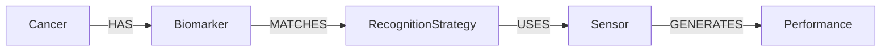
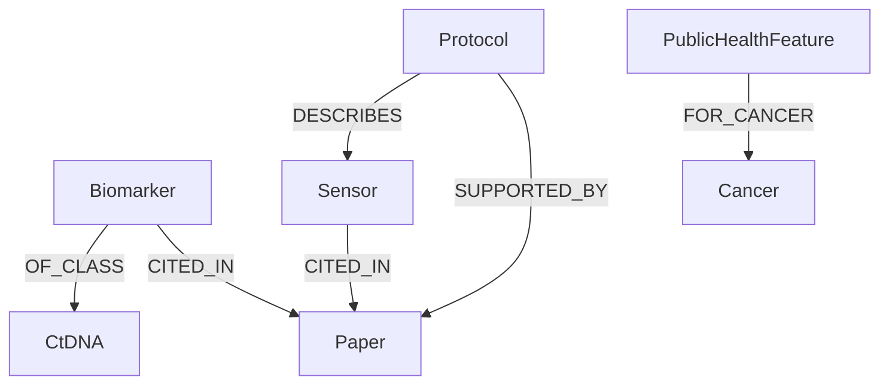
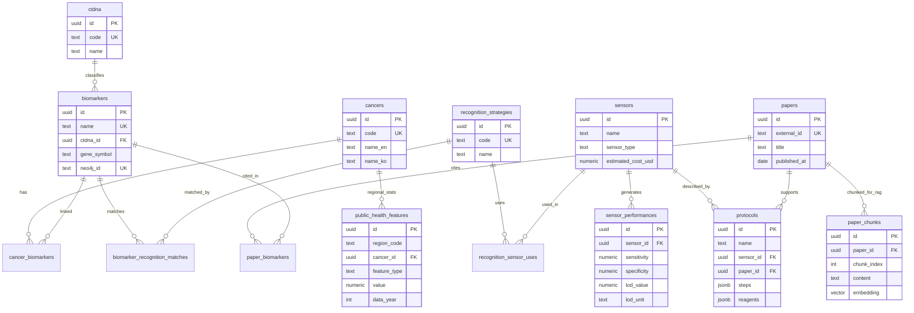
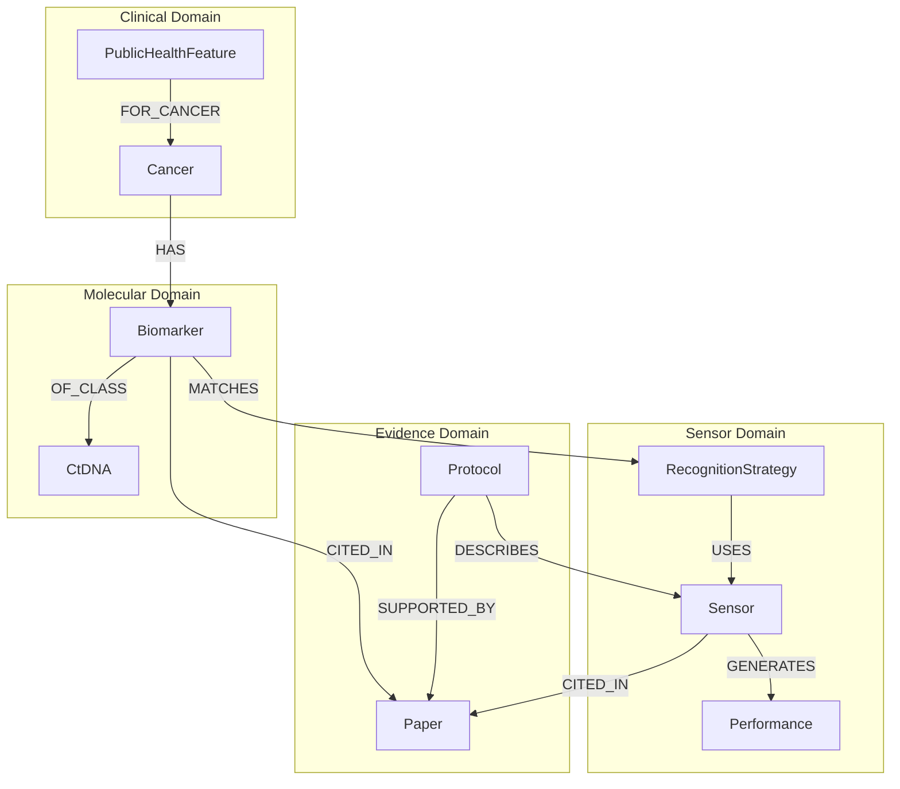

# BioSense-GovAI — Data Architecture

> Dual-store design: **PostgreSQL** (relational catalog + RAG + transactions) and **Neo4j** (graph traversal for co-design paths).

## Entity Overview

| Entity | Postgres Table | Neo4j Label | Purpose |
|--------|----------------|-------------|---------|
| Cancer | `cancers` | `Cancer` | Cancer type taxonomy |
| Biomarker | `biomarkers` | `Biomarker` | ctDNA-detectable marker |
| CtDNA | `ctdna` | `CtDNA` | Molecular class (mutation, methylation, …) |
| RecognitionStrategy | `recognition_strategies` | `RecognitionStrategy` | Molecular recognition approach |
| Sensor | `sensors` | `Sensor` | Biosensor platform |
| Performance | `sensor_performances` | `Performance` | Sensitivity, specificity, LOD |
| Paper | `papers` | `Paper` | Scientific literature (RAG source) |
| Protocol | `protocols` | `Protocol` | Experimental procedure |
| PublicHealthFeature | `public_health_features` | `PublicHealthFeature` | Korean regional cancer stats |

---

## Relationship Model

### Core Chain (User-specified)



### Extended Relationships



### Postgres Junction Tables

| Relationship | Table | Key Columns |
|--------------|-------|-------------|
| Cancer HAS Biomarker | `cancer_biomarkers` | `cancer_id`, `biomarker_id` |
| Biomarker MATCHES Recognition | `biomarker_recognition_matches` | `match_score`, `mechanism` |
| Recognition USES Sensor | `recognition_sensor_uses` | `efficiency` |
| Sensor GENERATES Performance | `sensor_performances` | `sensitivity`, `specificity`, `lod_*` |
| Paper ↔ Biomarker | `paper_biomarkers` | M:N |
| Paper ↔ Sensor | `paper_sensors` | M:N |

---

## PostgreSQL ER Diagram



---

## Neo4j Graph Schema



---

## Indexes

### PostgreSQL

| Table | Index | Type | Purpose |
|-------|-------|------|---------|
| `ctdna` | `idx_ctdna_code` | B-tree | Lookup by class |
| `cancers` | `idx_cancers_code` | B-tree | Lookup by cancer type |
| `biomarkers` | `idx_biomarkers_ctdna_id` | B-tree | Filter by ctDNA class |
| `biomarkers` | `idx_biomarkers_gene_symbol` | Partial B-tree | Gene search |
| `biomarker_recognition_matches` | `idx_brm_score` | B-tree DESC | Top matches |
| `sensors` | `idx_sensors_type` | B-tree | Filter by sensor type |
| `sensor_performances` | `idx_sensor_performances_lod` | Partial B-tree | LOD ranking |
| `paper_chunks` | `idx_paper_chunks_embedding` | IVFFlat | RAG cosine search |
| `papers` | `idx_papers_published_at` | B-tree DESC | Recent literature |
| `public_health_features` | `idx_phf_region`, `idx_phf_cancer` | B-tree | Regional queries |
| `recommendations` | `idx_recommendations_sensor` | B-tree | Join to catalog |

### Neo4j

| Index | Target | Purpose |
|-------|--------|---------|
| Uniqueness constraints | All entity keys | Idempotent MERGE |
| `biomarker_search` | Full-text | Biomarker name search |
| `paper_search` | Full-text | Literature title search |
| `phf_region` | `PublicHealthFeature.region_code` | Regional filter |

---

## Migrations

| File | Description |
|------|-------------|
| `infra/db/migrations/postgres/001_initial_schema.sql` | Users, cases, recommendations, RAG base |
| `infra/db/migrations/postgres/002_domain_entities.sql` | Domain entities + junction tables + renames |
| `infra/db/migrations/postgres/003_seed_domain_data.sql` | Reference + relationship seed data |
| `infra/db/migrations/neo4j/001_constraints.cypher` | Constraints + indexes |
| `infra/db/migrations/neo4j/002_seed_data.cypher` | Graph seed mirroring Postgres |

### Apply (Docker)

Postgres migrations auto-apply on first `docker compose up` via `docker-entrypoint-initdb.d`.

Neo4j seeds (manual):

```bash
cat infra/db/migrations/neo4j/001_constraints.cypher | cypher-shell -u neo4j -p biosense_dev
cat infra/db/migrations/neo4j/002_seed_data.cypher   | cypher-shell -u neo4j -p biosense_dev
```

---

## ORM (SQLAlchemy 2.0)

Location: `apps/api/src/biosense/infrastructure/persistence/postgres/`

| File | Role |
|------|------|
| `base.py` | `DeclarativeBase` |
| `session.py` | Async engine + `get_db_session()` |
| `models.py` | All entity + junction ORM models |

### Usage

```python
from biosense.infrastructure.persistence.postgres.session import get_db_session
from biosense.infrastructure.persistence.postgres.models import Biomarker, Cancer
from sqlalchemy import select

async for session in get_db_session():
    result = await session.execute(
        select(Biomarker).join(Biomarker.cancers).where(Cancer.code == "lung")
    )
    biomarkers = result.scalars().all()
```

---

## Cross-Store Sync Strategy

| Store | Role | When to Query |
|-------|------|---------------|
| Postgres | Source of truth for catalog + user data | CRUD, RAG, analytics |
| Neo4j | Traversal + path discovery | "What sensors match this biomarker?" |

`graph_sync_log` table tracks Postgres UUID ↔ Neo4j node ID for idempotent sync scripts (Phase 4).

---

## Seed Data Summary

| Entity | Count |
|--------|-------|
| CtDNA classes | 4 |
| Cancers | 9 |
| Biomarkers | 7 |
| Recognition strategies | 6 |
| Sensors | 6 |
| Sensor performances | 6 |
| Papers | 4 |
| Protocols | 3 |
| Public health features | 10 |
| Cancer–Biomarker links | 8 |
| Biomarker–Recognition matches | 8 |
| Recognition–Sensor uses | 8 |
