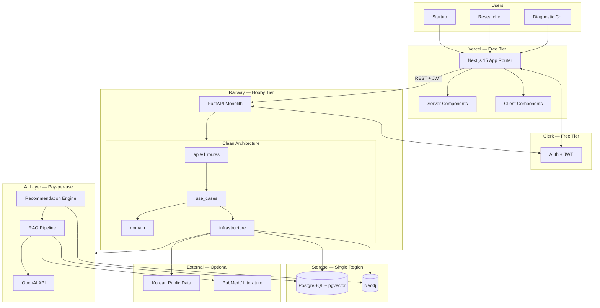
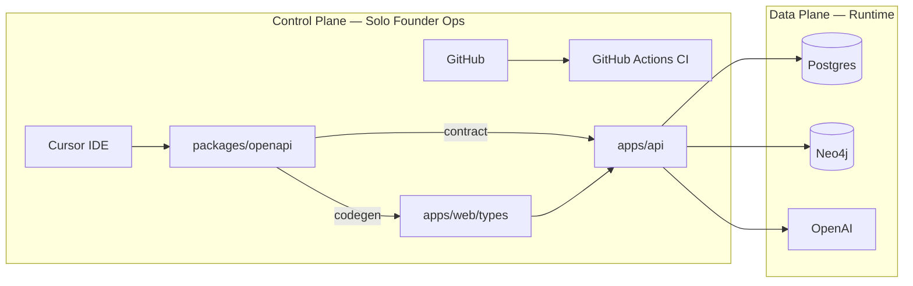
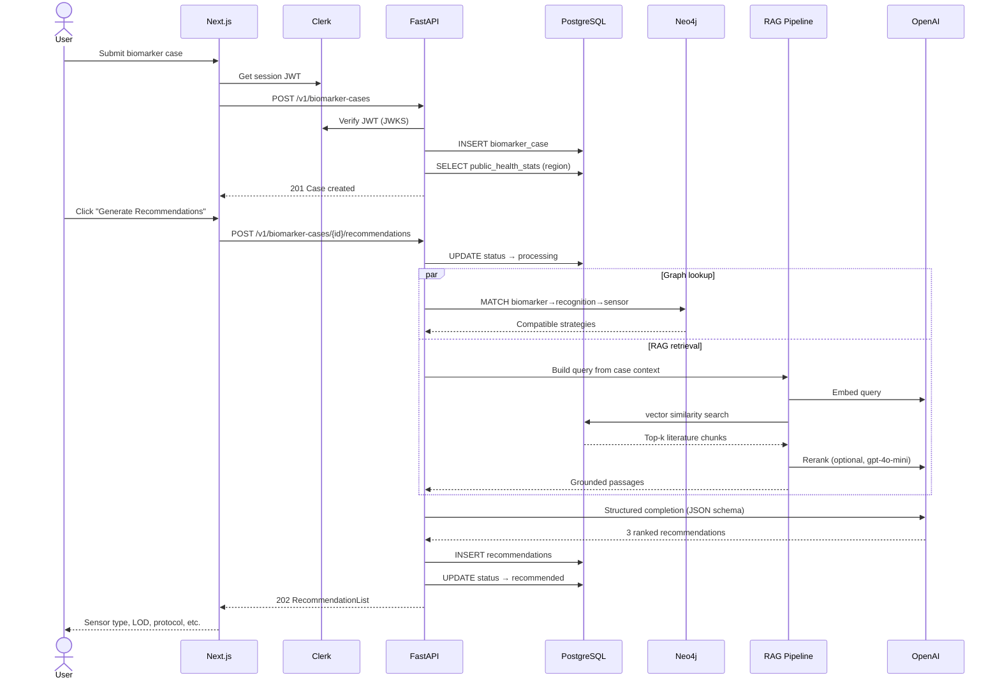
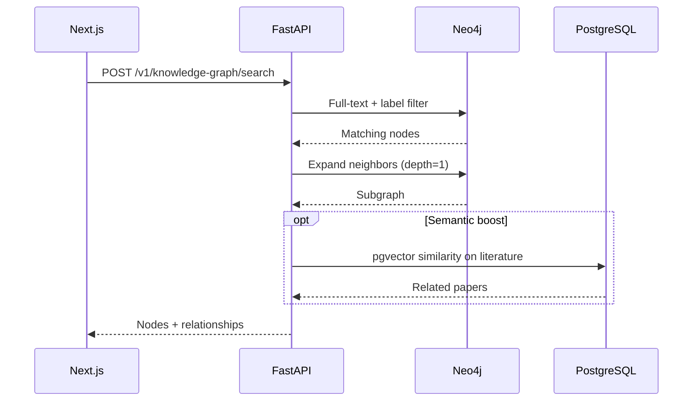
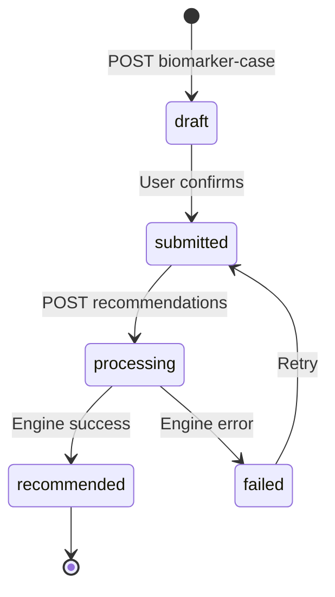
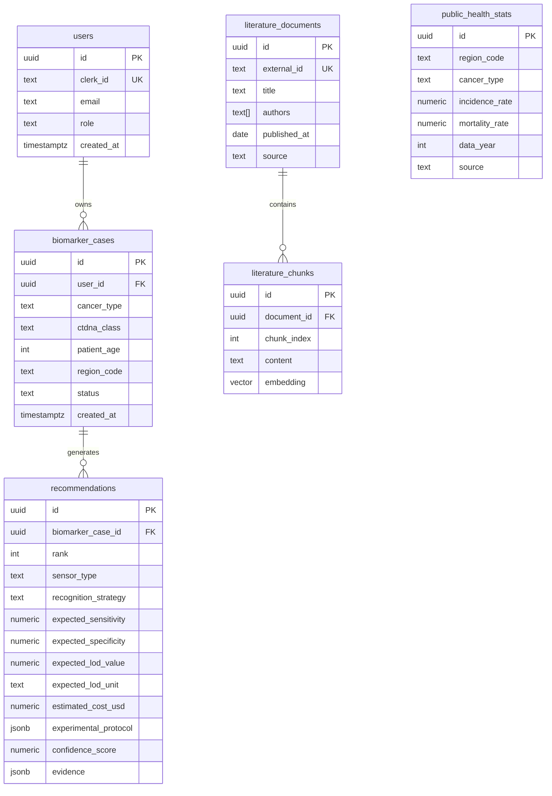
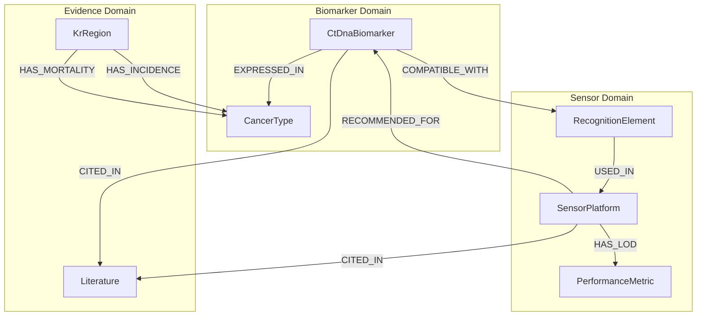
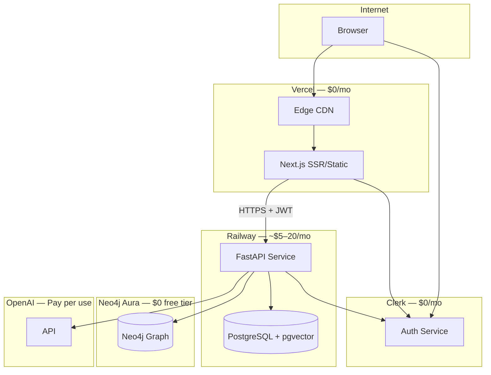
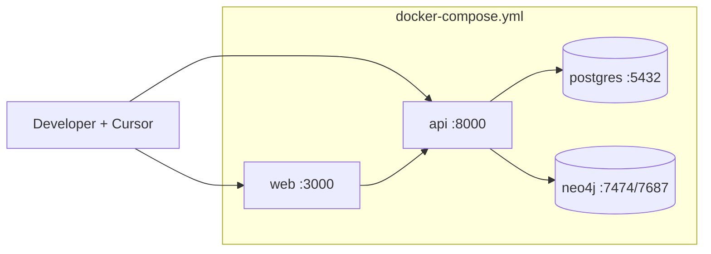
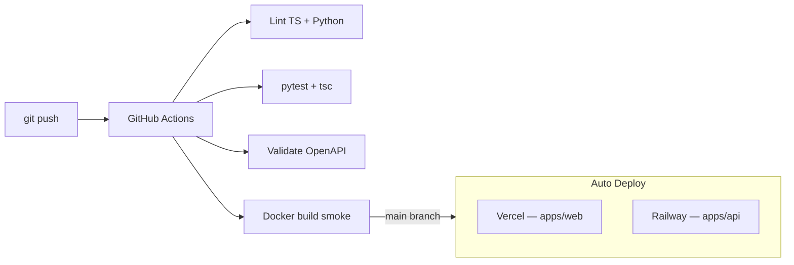

# BioSense-GovAI — System Architecture

> Optimized for **low cost**, **solo founder**, and **Cursor IDE** compatibility.

| Layer | Technology | Cost Strategy |
|-------|------------|---------------|
| Frontend | Next.js 15 + TypeScript + Tailwind + shadcn/ui | Vercel Hobby (free) |
| Backend | FastAPI (Python 3.12) | Railway Hobby (~$5/mo) |
| AI | OpenAI (GPT-4o + embeddings) | Cache embeddings in Postgres |
| Graph | Neo4j 5 Community | Aura Free tier or Docker sidecar |
| Search | RAG (pgvector) | Same Postgres instance — no Pinecone |
| Storage | PostgreSQL 16 + pgvector | Railway managed Postgres |
| Auth | Clerk | Free tier (10k MAU) |

**Deliberately excluded (MVP):** Redis, Kafka, Kubernetes, separate vector DB, microservices split.

---

## 1. Architecture Diagram

### 1.1 Logical Architecture



### 1.2 Data Plane vs Control Plane



### 1.3 Solo-Founder Simplification Rules

| Instead of | Use | Saves |
|------------|-----|-------|
| Celery + Redis | FastAPI `BackgroundTasks` | ~$7/mo + ops time |
| Pinecone / Weaviate | pgvector in Postgres | ~$70/mo |
| Microservices | Single FastAPI monolith | Cognitive load |
| Kafka | DB status column + polling | Infra complexity |
| k8s | Railway + Vercel | $100+/mo |
| Custom auth | Clerk | Weeks of dev |

---

## 2. Folder Structure

Monorepo — **one Cursor workspace**, clear boundaries, OpenAPI as contract hub.

```
BioSense-GovAI/
│
├── .cursor/
│   └── rules/
│       └── biosense.mdc              # Cursor agent conventions
│
├── apps/
│   ├── web/                          # Next.js — TypeScript only
│   │   └── src/
│   │       ├── app/                  # Routes (RSC-first)
│   │       ├── components/
│   │       │   ├── ui/               # shadcn primitives
│   │       │   └── features/         # Domain UI (1 folder per feature)
│   │       ├── lib/
│   │       │   └── api-client.ts     # Typed fetch → FastAPI
│   │       └── types/
│   │           └── api.ts            # Generated from OpenAPI
│   │
│   └── api/                          # FastAPI — Python only
│       └── src/biosense/
│           ├── api/v1/               # HTTP handlers (thin)
│           ├── application/
│           │   ├── use_cases/        # 1 file per user action
│           │   └── dto/              # Pydantic request/response
│           ├── domain/
│           │   ├── entities/
│           │   ├── value_objects/
│           │   ├── repositories/     # Abstract ports
│           │   └── services/         # RecommendationEngine, RAG
│           └── infrastructure/
│               ├── persistence/
│               │   ├── postgres/     # SQLAlchemy repos
│               │   └── neo4j/        # Cypher queries
│               ├── ai/
│               │   ├── openai_client.py
│               │   ├── rag_pipeline.py
│               │   └── embedding_service.py
│               ├── external/         # KOSIS, PubMed
│               └── auth/               # Clerk JWT
│
├── packages/
│   └── openapi/
│       └── openapi.yaml              # ★ Single source of truth
│
├── infra/
│   ├── db/migrations/
│   │   ├── postgres/                 # SQL migrations
│   │   └── neo4j/                    # Cypher seeds
│   └── seed/                         # Offline dev JSON
│
├── docs/
│   ├── SYSTEM_ARCHITECTURE.md        # This file
│   ├── ARCHITECTURE.md               # Deep-dive ADRs
│   └── ROADMAP.md
│
├── docker-compose.yml                # Local full stack
├── .env.example
└── package.json                      # npm workspaces (web only)
```

### Cursor Compatibility Conventions

| Rule | Why |
|------|-----|
| **One feature = one use_case file** | Cursor can edit a single 80-line file safely |
| **OpenAPI before implementation** | Agent generates matching frontend + backend |
| **`apps/web` ↔ `apps/api` never import each other** | Clear tool boundaries |
| **Max 3 levels in `components/features/`** | Predictable navigation for AI |
| **SQL migrations are numbered** | Agent can append `002_*.sql` without conflict |
| **No shared runtime package (yet)** | Avoids TS↔Python bridge complexity |

---

## 3. Event Flow

### 3.1 Primary Flow — Generate Recommendation



### 3.2 Knowledge Graph Search Flow



### 3.3 Background Events (No Message Broker)



| Event | Trigger | Handler | Storage |
|-------|---------|---------|---------|
| `case.created` | POST biomarker-cases | Sync | Postgres INSERT |
| `case.enriched` | After create | Sync fetch public data | Postgres cache |
| `recommendation.requested` | POST …/recommendations | FastAPI BackgroundTask | Status column |
| `recommendation.completed` | Engine done | Sync | Postgres INSERT |
| `literature.ingested` | Admin/cron (weekly) | Script | Postgres + pgvector |

> **Solo-founder note:** Status polling from frontend (`GET /v1/biomarker-cases/{id}`) replaces WebSockets/SSE until scale demands it.

---

## 4. Entity Diagram

### 4.1 PostgreSQL (Relational + Vectors)



### 4.2 Neo4j (Knowledge Graph)



### 4.3 Cross-Store Mapping

| Concept | Postgres | Neo4j |
|---------|----------|-------|
| User case | `biomarker_cases` row | — |
| Biomarker definition | Referenced by `ctdna_class` enum | `CtDnaBiomarker` node |
| Sensor strategy | `recommendations` row | Traversed path |
| Literature evidence | `literature_chunks` + embedding | `Literature` node + `CITED_IN` |
| Regional stats | `public_health_stats` cache | `KrRegion`→`CancerType` edges |

---

## 5. API List

Canonical spec: [`packages/openapi/openapi.yaml`](../packages/openapi/openapi.yaml)

### 5.1 Endpoints

| # | Method | Path | Tag | Auth | Description |
|---|--------|------|-----|------|-------------|
| 1 | `GET` | `/v1/health` | Health | — | Liveness + Postgres/Neo4j status |
| 2 | `GET` | `/v1/me` | Users | JWT | Current user profile (Clerk sync) |
| 3 | `GET` | `/v1/dashboard` | Dashboard | JWT | Case count, recent activity |
| 4 | `GET` | `/v1/biomarker-cases` | Biomarker Cases | JWT | Paginated list (`page`, `page_size`) |
| 5 | `POST` | `/v1/biomarker-cases` | Biomarker Cases | JWT | Create case (cancer, ctDNA, age, region) |
| 6 | `GET` | `/v1/biomarker-cases/{caseId}` | Biomarker Cases | JWT | Case detail + public data context |
| 7 | `POST` | `/v1/biomarker-cases/{caseId}/recommendations` | Recommendations | JWT | Run AI recommendation engine |
| 8 | `GET` | `/v1/recommendations/{recommendationId}` | Recommendations | JWT | Full recommendation output |
| 9 | `GET` | `/v1/public-data/regions` | Public Data | JWT | Korean administrative regions |
| 10 | `GET` | `/v1/public-data/cancer-stats` | Public Data | JWT | Incidence/mortality by region |
| 11 | `POST` | `/v1/knowledge-graph/search` | Knowledge Graph | JWT | Full-text + type-filtered search |
| 12 | `GET` | `/v1/knowledge-graph/nodes/{nodeId}` | Knowledge Graph | JWT | Node + neighbors (`depth=1..3`) |

### 5.2 Recommendation Output Contract

Every `POST …/recommendations` returns ranked items with:

| Field | Type | Example |
|-------|------|---------|
| `sensor_type` | enum | `electrochemical` |
| `recognition_strategy` | enum | `aptamer_based` |
| `expected_sensitivity` | 0–1 | `0.92` |
| `expected_specificity` | 0–1 | `0.95` |
| `expected_lod` | `{value, unit}` | `{0.1, "ng/mL"}` |
| `estimated_cost_usd` | number | `45.00` |
| `experimental_protocol` | `{steps, reagents, duration_hours}` | — |
| `confidence_score` | 0–1 | `0.87` |
| `evidence` | `{literature_ids, graph_paths}` | — |

### 5.3 Auth Model

```
Authorization: Bearer <clerk_session_jwt>
```

FastAPI validates via Clerk JWKS. User row upserted on first `GET /v1/me`.

---

## 6. Deployment Topology

### 6.1 Production



### 6.2 Local Development (Docker Compose)



```bash
cp .env.example .env
docker compose up -d
```

### 6.3 CI/CD Pipeline



Workflows: `.github/workflows/ci.yml`, `.github/workflows/deploy.yml`

### 6.4 Environment Matrix

| Variable | Local | Vercel | Railway |
|----------|-------|--------|---------|
| `NEXT_PUBLIC_API_URL` | `http://localhost:8000` | `https://api.*.railway.app` | — |
| `DATABASE_URL` | Docker Postgres | — | Auto-injected |
| `NEO4J_URI` | `bolt://localhost:7687` | — | Aura connection string |
| `OPENAI_API_KEY` | `.env` | — | Railway secret |
| `CLERK_SECRET_KEY` | `.env` | Vercel env | Railway secret |
| `NEXT_PUBLIC_CLERK_PUBLISHABLE_KEY` | `.env` | Vercel env | — |

### 6.5 Estimated Monthly Cost (Solo MVP)

| Service | Tier | Cost |
|---------|------|------|
| Vercel | Hobby | $0 |
| Railway | Hobby (API + Postgres) | ~$5–10 |
| Neo4j Aura | Free | $0 |
| Clerk | Free | $0 |
| GitHub Actions | Free (2000 min) | $0 |
| OpenAI | Usage-based | ~$10–30 |
| **Total** | | **~$15–40/mo** |

---

## Quick Reference

| Need | Go to |
|------|-------|
| API contract | `packages/openapi/openapi.yaml` |
| SQL schema | `infra/db/migrations/postgres/` |
| Graph seeds | `infra/db/migrations/neo4j/` |
| Run locally | `docker compose up -d` |
| Implementation plan | `docs/ROADMAP.md` |
| Cursor agent rules | `.cursor/rules/biosense.mdc` |
